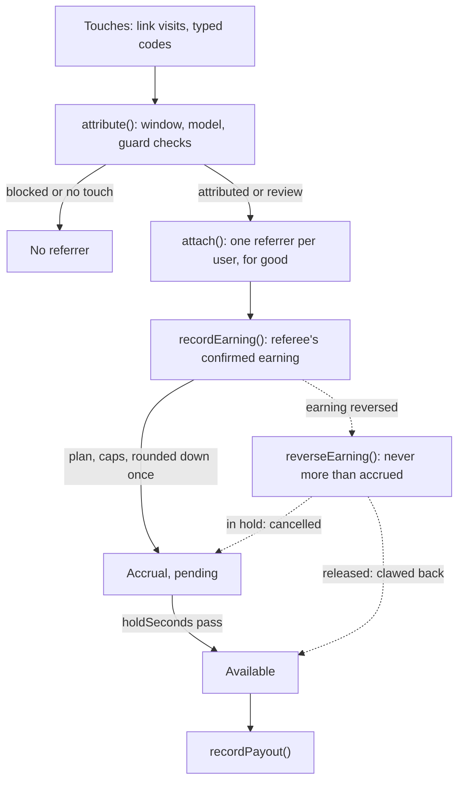

# referral-engine

**Referral codes, attribution with fraud checks, commission plans and an append-only commission ledger. Same behavior in JavaScript and PHP.**

[](https://github.com/moonetix/referral-engine/actions/workflows/ci.yml)
[](LICENSE)
[](package.json)
[](package.json)
[](composer.json)
[](https://www.npmjs.com/package/@moonetix/referral-engine)
[](https://packagist.org/packages/moonetix/referral-engine)
[](https://moonetix.com/academy/traffic-quality/prevent-referral-fraud)

Maintained by [Moonetix](https://moonetix.com).

Referral programs in apps, SaaS products, games and communities tend to break in the same places. A bonus paid at sign-up gets farmed with second accounts. Commission is paid on rewards that are reversed two weeks later. A clawback takes back more than the referrer ever received, or nothing at all. A friend types an O where the code has a 0 and the referral is lost.

This library covers the parts that have to be exact: codes people can read aloud, attribution with explainable guards, commission plans with caps, and a ledger where every commission links to the earning that produced it, so a reversal takes back exactly that commission and nothing more.

- **JavaScript:** ESM, zero dependencies, TypeScript declarations, Node 20+.
- **PHP:** 8.1+, zero dependencies. PDO only if you use `PdoStore`.
- **One spec:** both suites run the same [test vectors](test-vectors/vectors.json), 153 cases, including 16 ledger scenarios that also run on a real SQLite database.

Commission is earned only from the referred user's own confirmed earnings and is paid on top of them. There is no sign-up or invite bonus, by design: a reward for creating an account is the easiest money a referral farm can collect.

## The referral lifecycle



| Function | What it does |
| --- | --- |
| `generateCode(options)` | Random code from an unambiguous 29-character alphabet, no modulo bias, optional check character |
| `normalizeCode`, `isValidCode`, `formatCode` | Clean up typed input (case, spaces, hyphens), validate length and check character, group for display |
| `createUniqueCode(exists, options)` | Retry on collision against your own lookup |
| `attribute({ signup, touches, referrers, rules })` | Pick the referrer: attribution window, first or last touch, typed-code grace period, guard checks |
| `selfReferral`, `sameDevice`, `sameIp`, `samePayoutDestination` | Built-in guard checks; any function of the same shape works too |
| `definePlan(config)` | Validate a flat, percentage or tiered plan with duration and caps |
| `commissionFor(plan, amount, stats)` | Commission for one earning before caps, for previews and offer pages |
| `new ReferralEngine({ store, plan, ... })` | `attach`, `recordEarning`, `reverseEarning`, `recordPayout`, `recordAdjustment`, `balance`, `ledger` |
| `MemoryStore`, `SqliteStore` (JS), `PdoStore` (PHP) | Storage adapters. Any object with five methods works ([store interface](#the-ledger)) |
| `fraudSignals({ referrer, referees, edges, now })` | Score with readable reasons: shared devices, networks and payout destinations, bursts, earn-then-vanish, reversal rate, loops |
| `findRings(edges)` | Groups of accounts that refer each other in a loop |
| `ipPrefix(ip, { ipv4Prefix, ipv6Prefix })` | The network an address belongs to, as CIDR text |

## Quick start

The JavaScript package is on [npm](https://www.npmjs.com/package/@moonetix/referral-engine) and the PHP package is on [Packagist](https://packagist.org/packages/moonetix/referral-engine):

```bash
npm install @moonetix/referral-engine
composer require moonetix/referral-engine
```

**JavaScript**

<!-- example: examples/quickstart.mjs -->
```js
import { MemoryStore, ReferralEngine, attribute, formatCode, generateCode } from '@moonetix/referral-engine';

const DAY = 86400;
const engine = new ReferralEngine({
  store: new MemoryStore(),
  plan: { type: 'percentage', rateBps: 1000, durationSeconds: 365 * DAY, perRefereeCap: 50000 },
  holdSeconds: 14 * DAY,
});

// 1. Every user gets a short code to share. Store it with a UNIQUE constraint.
const code = generateCode();
console.log(formatCode(code).length); // -> 9

// 2. At sign-up, pick the referrer from the touches you recorded (link visits, typed codes).
const at = 1767225600; // 2026-01-01 00:00 UTC
const result = attribute({
  signup: { userId: 'u_2001', at, deviceIds: ['dev_b'], ips: ['198.51.100.23'] },
  touches: [{ referrerId: 'u_1001', code: 'WPEAJ39T', at: at - 3600 }],
  referrers: { u_1001: { deviceIds: ['dev_a'], ips: ['203.0.113.5'] } },
});
console.log(result.decision, result.referrerId); // -> attributed u_1001
if (result.referrerId) await engine.attach({ refereeId: 'u_2001', referrerId: result.referrerId, at });

// 3. The friend's own reward is confirmed (for example a credited postback): 10% on top.
const earned = await engine.recordEarning({ earningId: 'tx_9001', refereeId: 'u_2001', amount: 2500, at: at + DAY });
console.log(JSON.stringify(earned.commissions)); // -> [{"level":1,"referrerId":"u_1001","amount":250,"availableAt":1768521600}]
console.log(JSON.stringify(await engine.balance('u_1001', at + DAY))); // -> {"pending":250,"available":0,"total":250,"uncollected":0}

// 4. The reward is reversed before the hold ends: the commission is cancelled, once.
const reversed = await engine.reverseEarning({ earningId: 'tx_9001', at: at + 5 * DAY });
console.log(JSON.stringify(reversed.clawbacks)); // -> [{"level":1,"referrerId":"u_1001","amount":250,"uncollected":0}]
console.log(JSON.stringify(await engine.balance('u_1001', at + 30 * DAY))); // -> {"pending":0,"available":0,"total":0,"uncollected":0}
```

**PHP**

<!-- example: examples/quickstart.php -->
```php
<?php

require __DIR__ . '/vendor/autoload.php';

use Moonetix\ReferralEngine\MemoryStore;
use Moonetix\ReferralEngine\Referral;
use Moonetix\ReferralEngine\ReferralEngine;

const DAY = 86400;
$engine = new ReferralEngine([
    'store' => new MemoryStore(),
    'plan' => ['type' => 'percentage', 'rateBps' => 1000, 'durationSeconds' => 365 * DAY, 'perRefereeCap' => 50000],
    'holdSeconds' => 14 * DAY,
]);

// 1. Every user gets a short code to share. Store it with a UNIQUE constraint.
$code = Referral::generateCode();
echo strlen(Referral::formatCode($code)), "\n"; // -> 9

// 2. At sign-up, pick the referrer from the touches you recorded (link visits, typed codes).
$at = 1767225600; // 2026-01-01 00:00 UTC
$result = Referral::attribute([
    'signup' => ['userId' => 'u_2001', 'at' => $at, 'deviceIds' => ['dev_b'], 'ips' => ['198.51.100.23']],
    'touches' => [['referrerId' => 'u_1001', 'code' => 'WPEAJ39T', 'at' => $at - 3600]],
    'referrers' => ['u_1001' => ['deviceIds' => ['dev_a'], 'ips' => ['203.0.113.5']]],
]);
echo $result['decision'], ' ', $result['referrerId'], "\n"; // -> attributed u_1001
if ($result['referrerId'] !== null) {
    $engine->attach(['refereeId' => 'u_2001', 'referrerId' => $result['referrerId'], 'at' => $at]);
}

// 3. The friend's own reward is confirmed (for example a credited postback): 10% on top.
$earned = $engine->recordEarning(['earningId' => 'tx_9001', 'refereeId' => 'u_2001', 'amount' => 2500, 'at' => $at + DAY]);
echo json_encode($earned['commissions']), "\n"; // -> [{"level":1,"referrerId":"u_1001","amount":250,"availableAt":1768521600}]
echo json_encode($engine->balance('u_1001', $at + DAY)), "\n"; // -> {"pending":250,"available":0,"total":250,"uncollected":0}

// 4. The reward is reversed before the hold ends: the commission is cancelled, once.
$reversed = $engine->reverseEarning(['earningId' => 'tx_9001', 'at' => $at + 5 * DAY]);
echo json_encode($reversed['clawbacks']), "\n"; // -> [{"level":1,"referrerId":"u_1001","amount":250,"uncollected":0}]
echo json_encode($engine->balance('u_1001', $at + 30 * DAY)), "\n"; // -> {"pending":0,"available":0,"total":0,"uncollected":0}
```

Without Composer, require `php/autoload.php` from this repository instead of `vendor/autoload.php`.

Amounts are integers in your smallest unit: cents, points, or micro-dollars. JavaScript takes safe integers (up to 2^53 - 1) and PHP takes the same range, so a value means the same thing on both sides. Rates are basis points: 1000 is 10%. Instants are Unix seconds. IDs can be strings or integers and always come back as strings. Every error carries a stable code (`err.code` in JavaScript, `$e->errorCode` in PHP), such as `already_referred` or `insufficient_balance`.

## Codes people can type

The default alphabet is `23456789ABCDEFGHJKMNPQRSTVWXY`: 29 symbols without 0, O, 1, I, L, U and Z. `normalizeCode` accepts lowercase, spaces and hyphens, so `wpea-j39t` and `WPEA J39T` both become `WPEAJ39T`. With a custom alphabet that has 0 and 1 but not O, I or L, those letters are read as the digits.

With `checkChar: true` a ninth character is added. Because 29 is prime, a weighted sum modulo 29 catches every single wrong character and every swap of two neighbors, so `isValidCode` can reject a typo before you look the code up. The test suites check that exhaustively.

How often codes collide, for random 8-character codes (29^8 = 500,246,412,961 possibilities):

| Codes issued | Chance one new code hits an existing one | Chance of at least one collision while issuing them all |
| ---: | ---: | ---: |
| 100,000 | 1 in 5,000,000 | about 1% |
| 1,000,000 | 1 in 500,000 | about 63% |
| 10,000,000 | 1 in 50,000 | almost certain |

Collisions will happen on any program that grows, so `createUniqueCode` retries against your lookup, and the `referral_codes.code` column in the schemas is `UNIQUE`. Insert, and on a duplicate-key error generate again. With 10 characters, the chance of any collision across a million codes falls to about 0.1%.

## Configuration reference

**Commission plan** (`definePlan`, or the `plan` option of the engine)

| Option | Type | Default | Notes |
| --- | --- | --- | --- |
| `type` | `'percentage'` \| `'flat'` \| `'tiered'` | required | |
| `rateBps` | integer 0 to 10,000 | required for `percentage` | Share of the referee's earning, rounded down |
| `amount` | integer | required for `flat` | Fixed commission per qualifying earning |
| `trigger` | `'first'` \| `'every'` | `'first'` | `flat` only. `first` pays once per referee, again only if that commission was fully reversed |
| `basis` | `'referees'` \| `'volume'` | `'referees'` | `tiered` only. Qualified referees (with a net confirmed earning), or the sum of their confirmed earnings net of reversals, measured before the current earning |
| `tiers` | `[{ from, rateBps }]` | required for `tiered` | Starts at `from: 0`, strictly increasing |
| `minEarning` | integer | 1 | Smaller earnings produce no commission and do not qualify a referee |
| `durationSeconds` | integer or `null` | `null` (lifetime) | Commission stops this long after attribution, for example 31,536,000 for one year |
| `perEarningCap` | integer or `null` | `null` | Ceiling for one earning |
| `perRefereeCap` | integer or `null` | `null` | Lifetime ceiling per referee, net of clawbacks |
| `perReferrerCap` | `{ amount, periodSeconds }` or `null` | `null` | Ceiling per referrer per fixed UTC window, for example 2,592,000 seconds |

**Engine** (`new ReferralEngine(options)`)

| Option | Default | Notes |
| --- | --- | --- |
| `store` | required | `MemoryStore`, `SqliteStore`, `PdoStore` or your own |
| `plan` | required | A plan config or the result of `definePlan` |
| `holdSeconds` | 0 | An accrual stays pending this long. Set it at least as long as the hold on the referee's own reward |
| `allowNegativeBalance` | `true` | `false` stops a clawback of released commission at the available balance; the rest is reported as `uncollected` |
| `availableBalance(referrerId, at)` | ledger balance | The balance used for that floor when you move released commission into another wallet |
| `multiLevel` | `null` | `{ levels: [bps, ...], acknowledgeRegulatoryRisk: true }`. See [Multi-level commissions](#multi-level-commissions) |

**Attribution rules** (`attribute({ rules })`)

| Option | Default | Notes |
| --- | --- | --- |
| `model` | `'last'` | `'first'` or `'last'` touch. On equal times, `last` takes the later array item and `first` the earlier |
| `windowSeconds` | 2,592,000 (30 days) | Oldest touch that still counts at sign-up |
| `typedCodeGraceSeconds` | 604,800 (7 days) | A code with `source: 'typed'` may arrive this long after sign-up. Link touches after sign-up never count |
| `checks` | all four built-ins | Functions or descriptors such as `{ check: 'sameIp', ipv4Prefix: 24 }`. An empty array turns checks off |

| Built-in check | Default action | Fires when |
| --- | --- | --- |
| `selfReferral` | `block` | The touch belongs to the new account itself |
| `sameDevice` | `block` | The new account shares a device ID with the referrer |
| `sameIp` | `review` | Both used the same IPv4 address (`ipv4Prefix: 32`) or IPv6 /64 (`ipv6Prefix: 64`) |
| `samePayoutDestination` | `block` | Both use the same payout destination |

Each built-in takes `action` (`'block'` or `'review'`) to override its default; `sameIp` also takes `ipv4Prefix` and `ipv6Prefix`.

Candidates are tried in model order. A candidate with any `block` reason is skipped and the next referrer is tried; `review` reasons keep the referrer and set `decision: 'review'`. The result lists every reason with the referrer it applies to, so support can explain the outcome.

**Codes**: `length` (8), `alphabet` (the 29 symbols), `checkChar` (`false`), `randomBytes` (`crypto.getRandomValues` or `random_bytes`), `maxAttempts` for `createUniqueCode` (10). `formatCode` takes `groupSize` (4) and `separator` (`'-'`).

**Fraud signals** (`fraudSignals({ options })`): `ipv4Prefix` (24), `ipv6Prefix` (64), `networkClusterSize` (3), `burstSize` (5), `burstWindowSeconds` (3,600), `vanishMinCount` (2), `vanishEarnWithinSeconds` (259,200), `vanishInactiveSeconds` (1,209,600), `reversalRateBps` (3,000), `reversalMinEarned` (1), `reviewAt` (30), `highAt` (60), and `weights`, an object keyed by signal code with values 0 to 100.

## The ledger

Every change is an appended entry. Nothing is updated or deleted, and the reference schemas enforce that with triggers.

| Field | Meaning |
| --- | --- |
| `key` | Idempotency key: `accrual:<level>:<earningId>`, a clawback key per reversal ID, `payout:<id>`, `adjustment:<id>` |
| `type` | `accrual`, `clawback`, `payout` or `adjustment` |
| `referrerId`, `refereeId`, `earningId`, `level` | Who earns, from whom, from which earning, and at which level (1 unless multi-level is on) |
| `amount` | Signed: accruals add, clawbacks and payouts subtract, adjustments go either way |
| `baseAmount` | The referee earning behind an accrual, or the part of it a clawback reversed (negative) |
| `uncollected` | Clawbacks only: the part not taken back because of the balance floor |
| `at`, `availableAt` | When it happened, and when an accrual stops being pending |

`recordEarning` returns `status: 'accrued'`, `'duplicate'` (same `earningId` again, nothing written) or `'none'` with a `reason`: `no_referrer`, `before_referral`, `expired` or `below_minimum`. When a cap applies, `capped` names it. A zero commission is still recorded when a cap or a `first` trigger brings it to zero, so the earning counts toward tiers and a repeat is still a duplicate.

`reverseEarning` takes the reversed part of the referee's earning (`amount`, or the rest when omitted) and a `reversalId` (the earning ID by default, which makes a repeated full reversal a no-op). It claws back the same share of each commission built on that earning, rounded down, and the last reversal takes exactly what is left. A commission still in its hold is cancelled outright; that never pushes a balance below zero.

**Store interface.** `MemoryStore` is for tests. `SqliteStore` (import from `referral-engine/sqlite`) takes a `node:sqlite` `DatabaseSync` or a better-sqlite3 handle. `PdoStore` takes any PDO connection. Your own store needs:

| Method | Contract |
| --- | --- |
| `getReferral(refereeId)` | The referral or `null` |
| `insertReferral(referral)` | `false` when the referee already has one |
| `listEntries({ referrerId?, refereeId?, earningId? })` | Matching entries in insertion order |
| `appendEntries(entries)` | All or nothing; `false`, writing nothing, when a key exists |
| `withLock(key, fn)` | Run `fn` without interleaving writes for the same key. Optional in JavaScript: without it the engine queues its calls per key, which is enough only while a single process writes to the store |

Schemas: [schema/postgresql.sql](schema/postgresql.sql), [schema/mysql.sql](schema/mysql.sql), [schema/sqlite.sql](schema/sqlite.sql). Amount and time columns are `BIGINT`. CI runs every ledger vector against the SQLite schema in both languages, and loads the PostgreSQL and MySQL files into PostgreSQL 17, MySQL 8.4 and MariaDB 11.4 for the parallel payout test; review them against your own server version before you use them.

<!-- example: examples/sqlite.mjs -->
```js
import { readFileSync } from 'node:fs';
import { DatabaseSync } from 'node:sqlite';
import { ReferralEngine } from '@moonetix/referral-engine';
import { SqliteStore } from '@moonetix/referral-engine/sqlite';

const db = new DatabaseSync(':memory:'); // a file path in production
db.exec(readFileSync(new URL(import.meta.resolve('@moonetix/referral-engine/schema/sqlite.sql')), 'utf8'));

const engine = new ReferralEngine({ store: new SqliteStore(db), plan: { type: 'percentage', rateBps: 500 } });
await engine.attach({ refereeId: 'u_2001', referrerId: 'u_1001', at: 1767225600 });

// The same postback delivered three times at once still accrues once.
const results = await Promise.all([1, 2, 3].map(() => engine.recordEarning({ earningId: 'tx_9001', refereeId: 'u_2001', amount: 4000, at: 1767229200 })));
console.log(results.map((r) => r.status).join(' ')); // -> accrued duplicate duplicate
console.log(db.prepare('SELECT SUM(amount) AS total FROM referral_ledger').get()?.total); // -> 200
```

<!-- example: examples/pdo-sqlite.php -->
```php
<?php

require __DIR__ . '/vendor/autoload.php';

use Moonetix\ReferralEngine\PdoStore;
use Moonetix\ReferralEngine\ReferralEngine;

$pdo = new PDO('sqlite::memory:'); // or mysql:/pgsql: with schema/mysql.sql or schema/postgresql.sql
$pdo->exec(file_get_contents(__DIR__ . '/vendor/moonetix/referral-engine/schema/sqlite.sql'));

$engine = new ReferralEngine(['store' => new PdoStore($pdo), 'plan' => ['type' => 'percentage', 'rateBps' => 500]]);
$engine->attach(['refereeId' => 'u_2001', 'referrerId' => 'u_1001', 'at' => 1767225600]);

// The same postback delivered twice accrues once.
foreach ([1, 2] as $attempt) {
    $r = $engine->recordEarning(['earningId' => 'tx_9001', 'refereeId' => 'u_2001', 'amount' => 4000, 'at' => 1767229200]);
    echo $r['status'], "\n";
}
// -> accrued
// -> duplicate
echo $pdo->query('SELECT SUM(amount) FROM referral_ledger')->fetchColumn(), "\n"; // -> 200
```

`node:sqlite` works without a flag from Node 22.13; 22.5 to 22.12 need `--experimental-sqlite`. `PdoStore` runs each engine call in one transaction. SQLite allows one writer at a time, so that is enough there. On PostgreSQL and MySQL a transaction alone would let two workers read the same balance, so `withLock` also takes a lock named after its key before the first read: `pg_advisory_xact_lock` on PostgreSQL, held until the transaction ends, and `GET_LOCK` on MySQL and MariaDB, released after the commit. Two payouts for one referrer, or two copies of one earning, then run one after the other. Keep PostgreSQL at READ COMMITTED, its default, for these connections. On MySQL a call that waits more than 10 seconds for its lock throws `conflict`, and the engine should be called outside a transaction of your own: a named lock is released when the call returns, not when your transaction commits. At MySQL's default REPEATABLE READ, an earning that waited for another call of the same referrer still measures caps and tiers on the rows it saw when it started; use READ COMMITTED if a cap must hold exactly under parallel earnings. CI runs a parallel payout test against PostgreSQL, MySQL and MariaDB: eight connections ask for the same balance at the same moment, and exactly one of them is paid.

## Fraud signals

Most referral fraud is one person, or a small group, playing both sides. The useful checks compare the referrer with the accounts they referred, and the referred accounts with each other. `fraudSignals` does that for one referrer and returns a score with a sentence per signal, for a review queue rather than an automatic ban.

<!-- example: examples/fraud-signals.mjs -->
```js
import { fraudSignals } from '@moonetix/referral-engine';

const DAY = 86400;
const report = fraudSignals({
  referrer: { id: 'u_1001', deviceIds: ['dev_a'], ips: ['203.0.113.5'], payoutDestinations: ['paypal:5f1c'] },
  referees: [
    { id: 'u_2001', deviceIds: ['dev_b'], ips: ['198.51.100.23'], payoutDestinations: ['paypal:5f1c'], signedUpAt: 0, firstEarningAt: 3600, lastActiveAt: 7200, earned: 3000, reversed: 3000 },
    { id: 'u_2002', deviceIds: ['dev_c'], ips: ['198.51.100.24'], payoutDestinations: ['paypal:91aa'], signedUpAt: 600, firstEarningAt: 4000, lastActiveAt: 8000, earned: 2800, reversed: 1400 },
    { id: 'u_2003', deviceIds: ['dev_d'], ips: ['192.0.2.77'], payoutDestinations: ['paypal:0c3e'], signedUpAt: 20 * DAY, firstEarningAt: 22 * DAY, lastActiveAt: 40 * DAY, earned: 4000 },
  ],
  now: 40 * DAY,
});
console.log(report.score, report.level); // -> 75 high
for (const s of report.signals) console.log(`${s.code}: ${s.message}`);
// -> shared_payout_with_referrer: 1 referred account cashes out to a payout destination the referrer also uses.
// -> earn_then_vanish: 2 referred accounts earned within 3 days of signing up and have been inactive for 14 days or more.
// -> high_reversal_rate: Reversals are 44.89% of referred earnings (4400 of 9800).
```

The PHP version is [examples/fraud-signals.php](examples/fraud-signals.php) and prints the same lines.

| Signal | Default weight | Fires when |
| --- | ---: | --- |
| `shared_payout_with_referrer` | 40 | A referee cashes out to a destination the referrer uses |
| `shared_device_with_referrer` | 30 | A referee used one of the referrer's devices |
| `shared_network_with_referrer` | 10 | A referee used the referrer's /24 or /64 |
| `shared_payout_among_referees` | 30 | Two or more referees share a payout destination |
| `shared_device_among_referees` | 20 | Two or more referees share a device |
| `shared_network_among_referees` | 10 | `networkClusterSize` (3) or more referees share a /24 or /64 |
| `signup_burst` | 15 | `burstSize` (5) or more referees signed up within `burstWindowSeconds` (1 hour) |
| `earn_then_vanish` | 15 | `vanishMinCount` (2) or more referees earned within 3 days of sign-up and have been inactive for 14 days |
| `high_reversal_rate` | 20 | Reversals reach `reversalRateBps` (30%) of the tree's earnings |
| `referral_ring` | 40 | `edges` contain a loop that touches this referrer or a referee |

The score is the sum of weights, capped at 100. `level` is `review` from 30 (`reviewAt`) and `high` from 60 (`highAt`). Every threshold and weight is an option.

When a tree scores high, handle it as one case, the way the [referral fraud guide](https://moonetix.com/academy/traffic-quality/prevent-referral-fraud) describes: freeze pending commission and cashouts in the cluster instead of banning, list which accounts share what, compare what they did and how much was reversed, and decide per account. A real friend keeps their rewards even if the referrer cheated. Families and roommates share devices and Wi-Fi, and a streamer's audience arrives in a burst, so give people a human appeal.

## Multi-level commissions

Off by default. With `multiLevel: { levels: [300], acknowledgeRegulatoryRisk: true }` the referrer's own referrer also earns 3% of the same earning, and so on for up to four extra levels. Higher levels use their flat rate on the referee's earning, never on commission, with no tiers or caps. Without `acknowledgeRegulatoryRisk: true` the constructor throws `multi_level_not_acknowledged`.

> [!WARNING]
> Paying people for the referrals of their referrals is how pyramid schemes are built, and many jurisdictions regulate or prohibit schemes where rewards come mainly from recruiting rather than from a product. The EU Unfair Commercial Practices Directive ([2005/29/EC](https://eur-lex.europa.eu/eli/dir/2005/29/oj), Annex I, point 14) lists pyramid promotional schemes among the practices that are unfair in all circumstances, and the US FTC publishes [business guidance on multi-level marketing](https://www.ftc.gov/business-guidance/resources/business-guidance-concerning-multi-level-marketing). Multi-level commission also rewards account rings far more than real advocates. Pay one level, and get legal advice for every market you serve before you change that. This section is not legal advice.

## How it works

1. A code is drawn byte by byte from a cryptographic source. Bytes at or above the largest multiple of the alphabet size are skipped, so every symbol is equally likely.
2. You store touches as they happen: a link visit with the code, or a code typed at or after sign-up. `attribute` keeps the touches inside the window, orders them by the model, and runs the guard checks on each candidate referrer until one is not blocked.
3. `attach` stores one referral per referee. A second call with the same referrer is a no-op; a different referrer throws `already_referred`, and a chain that would loop throws `referral_cycle`.
4. When the referee's own reward is confirmed, `recordEarning` measures the referrer's tier, applies the plan, then the per-earning, per-referee and per-period caps, and appends one accrual keyed by the earning ID. The commission is computed as one integer product and rounded down once.
5. `balance(referrerId, at)` replays the referrer's entries up to `at`: accruals still in their hold are pending, the rest is available, minus clawbacks and payouts.
6. `reverseEarning` reads what was accrued for that earning and what was already clawed back, and appends a clawback for the difference between the new cumulative share and the old one. It can never exceed the original commission.
7. Each call runs inside the store's `withLock`, or inside the engine's own queue per key when a JavaScript store has none, and the ledger's unique key makes a concurrent duplicate fail instead of double-counting.

## Pitfalls

- **Paying on sign-up.** A sign-up takes seconds to fake. Pay from the referee's confirmed earnings, as this library does, or after a qualifying action that a fake account finds costly.
- **Accruing on credited instead of confirmed earnings.** If the referrer can cash out before the referee's reward clears its hold, a reversed reward has already paid commission. Call `recordEarning` when the referee's reward is confirmed, and set `holdSeconds` at least as long as your reward hold. [Reward hold periods](https://moonetix.com/academy/monetization/reward-hold-periods) covers how long that should be.
- **Partial reversals with one ID.** A reversal ID is an idempotency key. Use the network's transaction ID for a full reversal, and a distinct ID for each partial reversal of the same earning.
- **Recomputing commission at reversal time.** Rates and tiers change. The ledger stores the commission that was actually accrued, and clawbacks are measured against that.
- **Changing the referrer later.** Support requests to move a referral are a common fraud path. `attach` refuses it; do the same in your admin tools.
- **Treating a shared IP as proof.** Carrier-grade NAT, campuses and offices put many people behind one address. That is why `sameIp` reviews instead of blocking, and why network weights are low in `fraudSignals`.
- **Comparing raw payout destinations.** Normalize first (trim, lowercase emails, strip formatting from wallet addresses), then hash, and compare the hashes. Never send raw payout details to a fraud tool you do not need to.
- **Commission on commission.** The base is always the referee's own earning. Referral commission never counts as earnings for the next level up.
- **Showing referees to referrers.** Show a username, a status and the referrer's own reward. Never the friend's email or activity.
- **Rewards for store actions.** Never tie a referral reward to a rating or review; Google Play's policy forbids incentives for them. On iOS, App Review Guideline 5.1.2(v) requires contact invites to be chosen one by one by the user, with no Select All. [Referral program design](https://moonetix.com/academy/strategy/referral-program-design) covers the store rules.
- **Terms written after launch.** One account per person, no self-referrals, no paying people to sign up, commission depends on confirmed earnings, and clawbacks are possible. [Rewards site terms of service](https://moonetix.com/academy/monetization/rewards-site-terms-of-service) walks through the wording.

## Errors you will meet

| Code | Thrown by | What to do |
| --- | --- | --- |
| `already_referred` | `attach` | The referee already has a different referrer. Keep the first one; a repeat with the same referrer is a no-op and does not throw |
| `referral_cycle`, `self_referral` | `attach` | The pair would loop or is one user. Drop the referral |
| `insufficient_balance` | `recordPayout` | The message gives the available balance. Pending accruals cannot be paid out until `holdSeconds` pass. Payouts, clawbacks and negative adjustments already in the ledger always count, even when the new payout carries an earlier `at` |
| `conflict` | any ledger write | Another worker wrote the same ledger key between the check and the insert, usually because the store's `withLock` does not cover your workers. Retry the call: a repeated earning, payout or adjustment ID then returns `status: 'duplicate'` |
| `invalid_plan` | `definePlan`, the engine constructor | The message names the field, for example tiers that do not start at `from: 0` |
| `multi_level_not_acknowledged` | the engine constructor | `multiLevel` was set without `acknowledgeRegulatoryRisk: true` |
| `code_space_exhausted` | `createUniqueCode` | No free code after `maxAttempts`. Use longer codes |
| `invalid_code`, `alphabet_not_prime` | check character helpers | A character outside the alphabet, or `checkChar: true` with an alphabet whose size is not prime |
| `invalid_argument`, `invalid_ip`, `overflow` | any call | A wrong type, an unparseable IP, or an amount or time above 2^53 - 1 |

`ERR_UNKNOWN_BUILTIN_MODULE` for `node:sqlite` means Node is too old for the built-in SQLite module (see [The ledger](#the-ledger)); pass a better-sqlite3 handle or use your own store there.

## Tests

```bash
npm test                 # node --test: shared vectors, SQLite store, API tests, every example
php php/tests/run.php    # shared vectors on MemoryStore and PdoStore (SQLite), PHP-specific checks
php php/tests/concurrency.php   # parallel payouts on a real database, skipped without REFERRAL_TEST_DSN
```

`php/tests/concurrency.php` takes `REFERRAL_TEST_DSN` (`pgsql:`, `mysql:` or `sqlite:`) with `REFERRAL_TEST_USER` and `REFERRAL_TEST_PASSWORD`. It drops and recreates the referral tables there, so point it at a throwaway database. Worker processes with their own connections then call `recordPayout` at the same moment: one balance must be paid exactly once, and payouts for different referrers must all go through.

`test-vectors/vectors.json` holds 153 cases: code generation from fixed random bytes, check characters, IPv4 and IPv6 prefixes, every attribution rule, plan validation, commission math up to 2^53 - 1, fraud signals and 16 ledger scenarios (113 checked steps) with caps, tiers, holds, partial reversals, the balance floor, payouts dated out of order and multi-level chains. Every file in `examples/` runs in the tests, and its output must match the `// ->` comments, which are the same code blocks you see in this README.

## Further reading

- [How to prevent referral fraud on a rewards site](https://moonetix.com/academy/traffic-quality/prevent-referral-fraud): schemes, signals, payout rules and cluster review
- [Referral program design for apps](https://moonetix.com/academy/strategy/referral-program-design): structures, when to pay, caps, attribution and store rules
- [Reward hold periods](https://moonetix.com/academy/monetization/reward-hold-periods): pending, on hold and available, and how long to hold
- [Stop multi-accounting and VPN abuse](https://moonetix.com/academy/traffic-quality/stop-multi-accounting-vpn-abuse) and [KYC for rewards sites](https://moonetix.com/academy/traffic-quality/kyc-for-rewards-sites)
- [Rewards site terms of service](https://moonetix.com/academy/monetization/rewards-site-terms-of-service)

## About Moonetix

Moonetix is an affiliate network. Publishers add its offerwall to an app, game, website, bot or community, and users earn the publisher's own currency by completing offers. Publisher accounts: [moonetix.com/register](https://moonetix.com/register?from=github-referral-engine).

Other open source from Moonetix: [reward-economy-kit](https://github.com/moonetix/reward-economy-kit), [country-tiers](https://github.com/moonetix/country-tiers), [datacenter-ip-ranges](https://github.com/moonetix/datacenter-ip-ranges), [offerwall-fraud-playbook](https://github.com/moonetix/offerwall-fraud-playbook), [signup-guard](https://github.com/moonetix/signup-guard), [gamification-kit](https://github.com/moonetix/gamification-kit), [awesome-offerwalls](https://github.com/moonetix/awesome-offerwalls), [offerwall-postback-handlers](https://github.com/moonetix/offerwall-postback-handlers).

## License

MIT. See [LICENSE](LICENSE).
